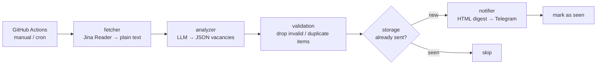

# 🔎 QA Vacancy Scout

[](https://github.com/Geektasilla/QA_Vacancy_Scout/actions/workflows/tests.yml)


A small automation that checks job boards for **fresh QA vacancies** and sends a digest to Telegram —
each vacancy only once. Built for my own job search and in use since March 2026.

Job boards change their HTML all the time, so instead of brittle CSS selectors the page is converted to
plain text and an LLM extracts the vacancies as **structured JSON**. Everything around the model is
plain, deterministic and covered by tests.

## How it works



| Module | Responsibility |
|---|---|
| [`fetcher.py`](vacancy_scout/fetcher.py) | Downloads the search page through [Jina Reader](https://jina.ai/reader), which strips markup and scripts |
| [`analyzer.py`](vacancy_scout/analyzer.py) | Prompts the model for vacancies from the last 24 h in a fixed JSON schema (`temperature=0`, JSON mode) and validates every item |
| [`storage.py`](vacancy_scout/storage.py) | Remembers delivered vacancy URLs; entries expire after 30 days |
| [`notifier.py`](vacancy_scout/notifier.py) | Builds an HTML digest (escaped, split at Telegram's 4096-char limit) and sends it |
| [`main.py`](vacancy_scout/main.py) | Orchestrates the pipeline; one failing board does not stop the others |
| [`config.py`](vacancy_scout/config.py) | Job boards to watch and settings from environment variables |

## Design decisions

- **LLM for extraction only, code for decisions.** The model only turns text into JSON. Filtering,
  de-duplication, formatting and delivery are ordinary code that can be unit-tested.
- **Never trust model output.** Invalid JSON, missing fields, relative or invented-looking links and duplicates
  are dropped instead of crashing the run.
- **De-duplication by vacancy URL.** The same job appearing again tomorrow is not re-sent.
- **At-least-once delivery.** A vacancy is marked as seen only *after* Telegram confirms delivery, so a failed
  send is retried on the next run.
- **No secrets in code, logs or git.** Credentials come from environment variables / GitHub Secrets,
  `Settings.__repr__` hides them, and network errors are re-raised without the request URL that contains the bot token.
- **Paid API calls only in the owner's repository.** The scout workflow can be started only by the repository
  owner, and it is guarded to run only in this repository, so forks never spend the OpenAI budget.
  The test workflow uses no secrets at all.
- **Clean repository.** The run state is kept in the GitHub Actions cache instead of being committed back by a bot.

## Testing

31 tests, no network and no API keys needed — OpenAI, Telegram and HTTP are replaced with fakes and mocks.

```bash
pip install -r requirements-dev.txt
pytest --cov=vacancy_scout
```

What is covered:

- **Analyzer:** valid extraction, request parameters (`temperature=0`, JSON mode, input truncation),
  6 kinds of malformed model output, invalid items, duplicates
- **Storage:** persistence between runs, 30-day pruning, corrupted state file
- **Notifier:** HTML escaping, message splitting under the Telegram limit, API errors, token never leaks into errors
- **Pipeline:** only unseen vacancies are sent, repeated runs send nothing, failed delivery is retried,
  no empty messages, required settings and secret masking

CI runs `ruff` and `pytest` on Python 3.10 and 3.12 for every push and pull request.

## Run it yourself

```bash
git clone https://github.com/Geektasilla/QA_Vacancy_Scout.git
cd QA_Vacancy_Scout
pip install -r requirements.txt
cp .env.example .env          # add your OpenAI key, Telegram bot token and chat id

DRY_RUN=true python -m vacancy_scout   # print the digest instead of sending it
python -m vacancy_scout                # send to Telegram
```

To run it in GitHub Actions, add `OPENAI_API_KEY`, `TELEGRAM_TOKEN` and `TELEGRAM_CHAT_ID` as repository
secrets and start the **Vacancy Scout** workflow (or enable the `schedule` trigger in
[`scout.yml`](.github/workflows/scout.yml)).

Job boards are configured in [`config.py`](vacancy_scout/config.py) — any search results URL works.
